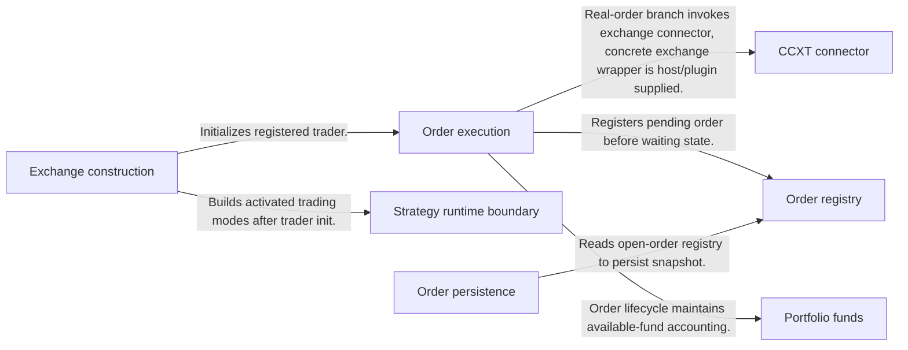
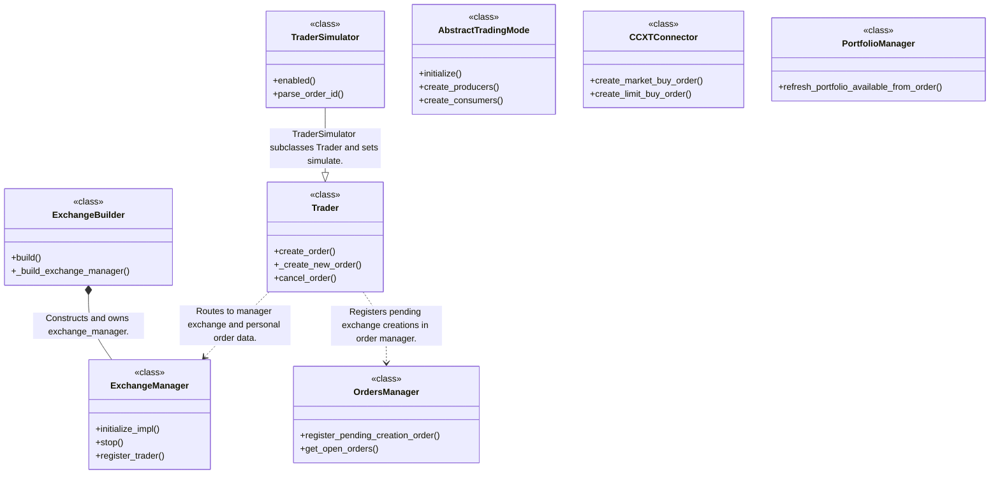
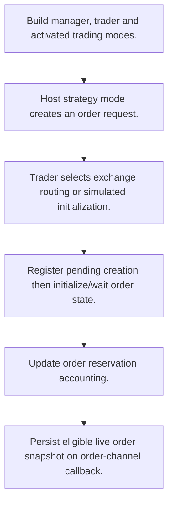
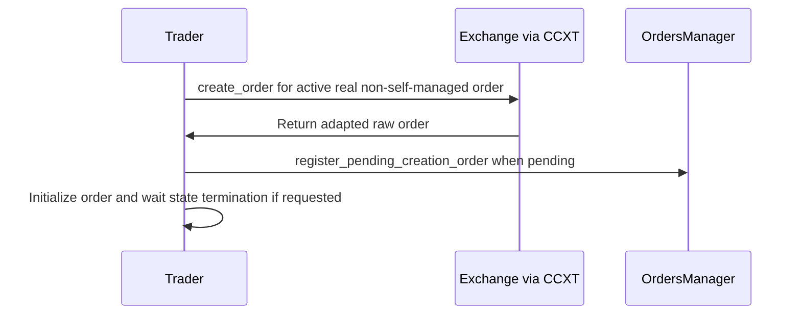

# OctoBot-Trading: workflow, design and architecture

Updated: **2026-10-13**
Reviewed Git hash: `4a1eaa90ea2f0058e759fd84b26646d224f8c844`
Branch: `feature/ayu_develop`
Source diff SHA256: `e3b0c44298fc1c149afbf4c8996fb92427ae41e4649b934ca495991b7852b855`
Scope: **Execution / exchange framework** / Maintenance: **companion**
Languages: Python

[HTML edition](ayu-develop.html) / [Development](development.md) / [Historical validation](validation.md) / [Full system comparison](../../docs/index.html)

## Purpose and scope

Build live or simulated exchange sessions, run trading-mode channels, manage order state and portfolio reservations, and persist trading data.

## Features and support boundaries

Native = implemented here. Integration = supplied through a named host/API. Limited = material restriction. Not provided = evidenced scope exclusion. Unverified = support/absence not established. Not applicable = outside this artifact type.

| Capability | Status | Implementation and limits | Source |
|---|---|---|---|
| Backtesting | Integration | Exchange builder accepts backtesting session/config; replay clock/files are supplied by OctoBot-Backtesting. | [ExchangeBuilder._build_exchange_manager](../src/octobot_trading/exchanges/exchange_builder.py) ([L58](https://github.com/alexcwyu/OctoBot-Trading/blob/4a1eaa90ea2f0058e759fd84b26646d224f8c844/src/octobot_trading/exchanges/exchange_builder.py#L58)) |
| Live execution | Native | Order routing, simulator branch, pending registry, mode channels, portfolio reservations and live snapshot persistence are implemented locally; external exchange access remains unexercised. | [Trader._create_new_order](../src/octobot_trading/exchanges/traders/trader.py) ([L332](https://github.com/alexcwyu/OctoBot-Trading/blob/4a1eaa90ea2f0058e759fd84b26646d224f8c844/src/octobot_trading/exchanges/traders/trader.py#L332)) / [TraderSimulator.__init__](../src/octobot_trading/exchanges/traders/trader_simulator.py) ([L36](https://github.com/alexcwyu/OctoBot-Trading/blob/4a1eaa90ea2f0058e759fd84b26646d224f8c844/src/octobot_trading/exchanges/traders/trader_simulator.py#L36)) / [OrdersManager.register_pending_creation_order](../src/octobot_trading/personal_data/orders/orders_manager.py) ([L166](https://github.com/alexcwyu/OctoBot-Trading/blob/4a1eaa90ea2f0058e759fd84b26646d224f8c844/src/octobot_trading/personal_data/orders/orders_manager.py#L166)) / [AbstractTradingMode.initialize](../src/octobot_trading/modes/abstract_trading_mode.py) ([L235](https://github.com/alexcwyu/OctoBot-Trading/blob/4a1eaa90ea2f0058e759fd84b26646d224f8c844/src/octobot_trading/modes/abstract_trading_mode.py#L235)) / [PortfolioManager.refresh_portfolio_available_from_order](../src/octobot_trading/personal_data/portfolios/portfolio_manager.py) ([L334](https://github.com/alexcwyu/OctoBot-Trading/blob/4a1eaa90ea2f0058e759fd84b26646d224f8c844/src/octobot_trading/personal_data/portfolios/portfolio_manager.py#L334)) / [OrdersStorage._live_callback](../src/octobot_trading/storage/orders_storage.py) ([L56](https://github.com/alexcwyu/OctoBot-Trading/blob/4a1eaa90ea2f0058e759fd84b26646d224f8c844/src/octobot_trading/storage/orders_storage.py#L56)) |
| Paper trading | Native | Order routing, simulator branch, pending registry, mode channels, portfolio reservations and live snapshot persistence are implemented locally; external exchange access remains unexercised. | [Trader._create_new_order](../src/octobot_trading/exchanges/traders/trader.py) ([L332](https://github.com/alexcwyu/OctoBot-Trading/blob/4a1eaa90ea2f0058e759fd84b26646d224f8c844/src/octobot_trading/exchanges/traders/trader.py#L332)) / [TraderSimulator.__init__](../src/octobot_trading/exchanges/traders/trader_simulator.py) ([L36](https://github.com/alexcwyu/OctoBot-Trading/blob/4a1eaa90ea2f0058e759fd84b26646d224f8c844/src/octobot_trading/exchanges/traders/trader_simulator.py#L36)) / [OrdersManager.register_pending_creation_order](../src/octobot_trading/personal_data/orders/orders_manager.py) ([L166](https://github.com/alexcwyu/OctoBot-Trading/blob/4a1eaa90ea2f0058e759fd84b26646d224f8c844/src/octobot_trading/personal_data/orders/orders_manager.py#L166)) / [AbstractTradingMode.initialize](../src/octobot_trading/modes/abstract_trading_mode.py) ([L235](https://github.com/alexcwyu/OctoBot-Trading/blob/4a1eaa90ea2f0058e759fd84b26646d224f8c844/src/octobot_trading/modes/abstract_trading_mode.py#L235)) / [PortfolioManager.refresh_portfolio_available_from_order](../src/octobot_trading/personal_data/portfolios/portfolio_manager.py) ([L334](https://github.com/alexcwyu/OctoBot-Trading/blob/4a1eaa90ea2f0058e759fd84b26646d224f8c844/src/octobot_trading/personal_data/portfolios/portfolio_manager.py#L334)) / [OrdersStorage._live_callback](../src/octobot_trading/storage/orders_storage.py) ([L56](https://github.com/alexcwyu/OctoBot-Trading/blob/4a1eaa90ea2f0058e759fd84b26646d224f8c844/src/octobot_trading/storage/orders_storage.py#L56)) |
| Event driven | Native | Order routing, simulator branch, pending registry, mode channels, portfolio reservations and live snapshot persistence are implemented locally; external exchange access remains unexercised. | [Trader._create_new_order](../src/octobot_trading/exchanges/traders/trader.py) ([L332](https://github.com/alexcwyu/OctoBot-Trading/blob/4a1eaa90ea2f0058e759fd84b26646d224f8c844/src/octobot_trading/exchanges/traders/trader.py#L332)) / [TraderSimulator.__init__](../src/octobot_trading/exchanges/traders/trader_simulator.py) ([L36](https://github.com/alexcwyu/OctoBot-Trading/blob/4a1eaa90ea2f0058e759fd84b26646d224f8c844/src/octobot_trading/exchanges/traders/trader_simulator.py#L36)) / [OrdersManager.register_pending_creation_order](../src/octobot_trading/personal_data/orders/orders_manager.py) ([L166](https://github.com/alexcwyu/OctoBot-Trading/blob/4a1eaa90ea2f0058e759fd84b26646d224f8c844/src/octobot_trading/personal_data/orders/orders_manager.py#L166)) / [AbstractTradingMode.initialize](../src/octobot_trading/modes/abstract_trading_mode.py) ([L235](https://github.com/alexcwyu/OctoBot-Trading/blob/4a1eaa90ea2f0058e759fd84b26646d224f8c844/src/octobot_trading/modes/abstract_trading_mode.py#L235)) / [PortfolioManager.refresh_portfolio_available_from_order](../src/octobot_trading/personal_data/portfolios/portfolio_manager.py) ([L334](https://github.com/alexcwyu/OctoBot-Trading/blob/4a1eaa90ea2f0058e759fd84b26646d224f8c844/src/octobot_trading/personal_data/portfolios/portfolio_manager.py#L334)) / [OrdersStorage._live_callback](../src/octobot_trading/storage/orders_storage.py) ([L56](https://github.com/alexcwyu/OctoBot-Trading/blob/4a1eaa90ea2f0058e759fd84b26646d224f8c844/src/octobot_trading/storage/orders_storage.py#L56)) |
| Vectorized | Unverified | Representative source review did not establish this capability; no claim of absence. | Not applicable to this repository scope. |
| Order management | Native | Order routing, simulator branch, pending registry, mode channels, portfolio reservations and live snapshot persistence are implemented locally; external exchange access remains unexercised. | [Trader._create_new_order](../src/octobot_trading/exchanges/traders/trader.py) ([L332](https://github.com/alexcwyu/OctoBot-Trading/blob/4a1eaa90ea2f0058e759fd84b26646d224f8c844/src/octobot_trading/exchanges/traders/trader.py#L332)) / [TraderSimulator.__init__](../src/octobot_trading/exchanges/traders/trader_simulator.py) ([L36](https://github.com/alexcwyu/OctoBot-Trading/blob/4a1eaa90ea2f0058e759fd84b26646d224f8c844/src/octobot_trading/exchanges/traders/trader_simulator.py#L36)) / [OrdersManager.register_pending_creation_order](../src/octobot_trading/personal_data/orders/orders_manager.py) ([L166](https://github.com/alexcwyu/OctoBot-Trading/blob/4a1eaa90ea2f0058e759fd84b26646d224f8c844/src/octobot_trading/personal_data/orders/orders_manager.py#L166)) / [AbstractTradingMode.initialize](../src/octobot_trading/modes/abstract_trading_mode.py) ([L235](https://github.com/alexcwyu/OctoBot-Trading/blob/4a1eaa90ea2f0058e759fd84b26646d224f8c844/src/octobot_trading/modes/abstract_trading_mode.py#L235)) / [PortfolioManager.refresh_portfolio_available_from_order](../src/octobot_trading/personal_data/portfolios/portfolio_manager.py) ([L334](https://github.com/alexcwyu/OctoBot-Trading/blob/4a1eaa90ea2f0058e759fd84b26646d224f8c844/src/octobot_trading/personal_data/portfolios/portfolio_manager.py#L334)) / [OrdersStorage._live_callback](../src/octobot_trading/storage/orders_storage.py) ([L56](https://github.com/alexcwyu/OctoBot-Trading/blob/4a1eaa90ea2f0058e759fd84b26646d224f8c844/src/octobot_trading/storage/orders_storage.py#L56)) |
| Order types | Native | Order routing, simulator branch, pending registry, mode channels, portfolio reservations and live snapshot persistence are implemented locally; external exchange access remains unexercised. | [Trader._create_new_order](../src/octobot_trading/exchanges/traders/trader.py) ([L332](https://github.com/alexcwyu/OctoBot-Trading/blob/4a1eaa90ea2f0058e759fd84b26646d224f8c844/src/octobot_trading/exchanges/traders/trader.py#L332)) / [TraderSimulator.__init__](../src/octobot_trading/exchanges/traders/trader_simulator.py) ([L36](https://github.com/alexcwyu/OctoBot-Trading/blob/4a1eaa90ea2f0058e759fd84b26646d224f8c844/src/octobot_trading/exchanges/traders/trader_simulator.py#L36)) / [OrdersManager.register_pending_creation_order](../src/octobot_trading/personal_data/orders/orders_manager.py) ([L166](https://github.com/alexcwyu/OctoBot-Trading/blob/4a1eaa90ea2f0058e759fd84b26646d224f8c844/src/octobot_trading/personal_data/orders/orders_manager.py#L166)) / [AbstractTradingMode.initialize](../src/octobot_trading/modes/abstract_trading_mode.py) ([L235](https://github.com/alexcwyu/OctoBot-Trading/blob/4a1eaa90ea2f0058e759fd84b26646d224f8c844/src/octobot_trading/modes/abstract_trading_mode.py#L235)) / [PortfolioManager.refresh_portfolio_available_from_order](../src/octobot_trading/personal_data/portfolios/portfolio_manager.py) ([L334](https://github.com/alexcwyu/OctoBot-Trading/blob/4a1eaa90ea2f0058e759fd84b26646d224f8c844/src/octobot_trading/personal_data/portfolios/portfolio_manager.py#L334)) / [OrdersStorage._live_callback](../src/octobot_trading/storage/orders_storage.py) ([L56](https://github.com/alexcwyu/OctoBot-Trading/blob/4a1eaa90ea2f0058e759fd84b26646d224f8c844/src/octobot_trading/storage/orders_storage.py#L56)) |
| Multi venue | Integration | Exchange registry and CCXT connector combine with concrete tentacle venue overrides; local FutureContract represents inverse/linear contracts. | [ExchangeBuilder._build_exchange_manager](../src/octobot_trading/exchanges/exchange_builder.py) ([L58](https://github.com/alexcwyu/OctoBot-Trading/blob/4a1eaa90ea2f0058e759fd84b26646d224f8c844/src/octobot_trading/exchanges/exchange_builder.py#L58)) / [CCXTConnector.create_market_buy_order](../src/octobot_trading/exchanges/connectors/ccxt/ccxt_connector.py) ([L728](https://github.com/alexcwyu/OctoBot-Trading/blob/4a1eaa90ea2f0058e759fd84b26646d224f8c844/src/octobot_trading/exchanges/connectors/ccxt/ccxt_connector.py#L728)) / [FutureContract.is_inverse_contract](../src/octobot_trading/exchange_data/contracts/future_contract.py) ([L56](https://github.com/alexcwyu/OctoBot-Trading/blob/4a1eaa90ea2f0058e759fd84b26646d224f8c844/src/octobot_trading/exchange_data/contracts/future_contract.py#L56)) |
| Crypto | Integration | Exchange registry and CCXT connector combine with concrete tentacle venue overrides; local FutureContract represents inverse/linear contracts. | [ExchangeBuilder._build_exchange_manager](../src/octobot_trading/exchanges/exchange_builder.py) ([L58](https://github.com/alexcwyu/OctoBot-Trading/blob/4a1eaa90ea2f0058e759fd84b26646d224f8c844/src/octobot_trading/exchanges/exchange_builder.py#L58)) / [CCXTConnector.create_market_buy_order](../src/octobot_trading/exchanges/connectors/ccxt/ccxt_connector.py) ([L728](https://github.com/alexcwyu/OctoBot-Trading/blob/4a1eaa90ea2f0058e759fd84b26646d224f8c844/src/octobot_trading/exchanges/connectors/ccxt/ccxt_connector.py#L728)) / [FutureContract.is_inverse_contract](../src/octobot_trading/exchange_data/contracts/future_contract.py) ([L56](https://github.com/alexcwyu/OctoBot-Trading/blob/4a1eaa90ea2f0058e759fd84b26646d224f8c844/src/octobot_trading/exchange_data/contracts/future_contract.py#L56)) |
| Equities | Unverified | Representative source review did not establish this capability; no claim of absence. | Not applicable to this repository scope. |
| Futures | Integration | Exchange registry and CCXT connector combine with concrete tentacle venue overrides; local FutureContract represents inverse/linear contracts. | [ExchangeBuilder._build_exchange_manager](../src/octobot_trading/exchanges/exchange_builder.py) ([L58](https://github.com/alexcwyu/OctoBot-Trading/blob/4a1eaa90ea2f0058e759fd84b26646d224f8c844/src/octobot_trading/exchanges/exchange_builder.py#L58)) / [CCXTConnector.create_market_buy_order](../src/octobot_trading/exchanges/connectors/ccxt/ccxt_connector.py) ([L728](https://github.com/alexcwyu/OctoBot-Trading/blob/4a1eaa90ea2f0058e759fd84b26646d224f8c844/src/octobot_trading/exchanges/connectors/ccxt/ccxt_connector.py#L728)) / [FutureContract.is_inverse_contract](../src/octobot_trading/exchange_data/contracts/future_contract.py) ([L56](https://github.com/alexcwyu/OctoBot-Trading/blob/4a1eaa90ea2f0058e759fd84b26646d224f8c844/src/octobot_trading/exchange_data/contracts/future_contract.py#L56)) |
| Options | Unverified | Enum/builder compatibility alone is not evidence of complete option order/contract execution; representative reviewed paths focused on spot/futures. | [TraderOrderType](../src/octobot_trading/enums.py) ([L146](https://github.com/alexcwyu/OctoBot-Trading/blob/4a1eaa90ea2f0058e759fd84b26646d224f8c844/src/octobot_trading/enums.py#L146)) / [ExchangeBuilder._build_exchange_manager](../src/octobot_trading/exchanges/exchange_builder.py) ([L58](https://github.com/alexcwyu/OctoBot-Trading/blob/4a1eaa90ea2f0058e759fd84b26646d224f8c844/src/octobot_trading/exchanges/exchange_builder.py#L58)) |
| Forex | Unverified | Representative source review did not establish this capability; no claim of absence. | Not applicable to this repository scope. |
| Strategy api | Native | AbstractTradingMode producer/consumer API supports host-supplied modes. | [AbstractTradingMode.initialize](../src/octobot_trading/modes/abstract_trading_mode.py) ([L235](https://github.com/alexcwyu/OctoBot-Trading/blob/4a1eaa90ea2f0058e759fd84b26646d224f8c844/src/octobot_trading/modes/abstract_trading_mode.py#L235)) |
| Optimization | Unverified | Representative source review did not establish this capability; no claim of absence. | Not applicable to this repository scope. |
| Machine learning | Unverified | Representative source review did not establish this capability; no claim of absence. | Not applicable to this repository scope. |
| Reinforcement learning | Unverified | Representative source review did not establish this capability; no claim of absence. | Not applicable to this repository scope. |
| Portfolio | Native | Order routing, simulator branch, pending registry, mode channels, portfolio reservations and live snapshot persistence are implemented locally; external exchange access remains unexercised. | [Trader._create_new_order](../src/octobot_trading/exchanges/traders/trader.py) ([L332](https://github.com/alexcwyu/OctoBot-Trading/blob/4a1eaa90ea2f0058e759fd84b26646d224f8c844/src/octobot_trading/exchanges/traders/trader.py#L332)) / [TraderSimulator.__init__](../src/octobot_trading/exchanges/traders/trader_simulator.py) ([L36](https://github.com/alexcwyu/OctoBot-Trading/blob/4a1eaa90ea2f0058e759fd84b26646d224f8c844/src/octobot_trading/exchanges/traders/trader_simulator.py#L36)) / [OrdersManager.register_pending_creation_order](../src/octobot_trading/personal_data/orders/orders_manager.py) ([L166](https://github.com/alexcwyu/OctoBot-Trading/blob/4a1eaa90ea2f0058e759fd84b26646d224f8c844/src/octobot_trading/personal_data/orders/orders_manager.py#L166)) / [AbstractTradingMode.initialize](../src/octobot_trading/modes/abstract_trading_mode.py) ([L235](https://github.com/alexcwyu/OctoBot-Trading/blob/4a1eaa90ea2f0058e759fd84b26646d224f8c844/src/octobot_trading/modes/abstract_trading_mode.py#L235)) / [PortfolioManager.refresh_portfolio_available_from_order](../src/octobot_trading/personal_data/portfolios/portfolio_manager.py) ([L334](https://github.com/alexcwyu/OctoBot-Trading/blob/4a1eaa90ea2f0058e759fd84b26646d224f8c844/src/octobot_trading/personal_data/portfolios/portfolio_manager.py#L334)) / [OrdersStorage._live_callback](../src/octobot_trading/storage/orders_storage.py) ([L56](https://github.com/alexcwyu/OctoBot-Trading/blob/4a1eaa90ea2f0058e759fd84b26646d224f8c844/src/octobot_trading/storage/orders_storage.py#L56)) |
| Risk management | Limited | Fund reservation and order state/risk parameter support are native; this audit does not establish a comprehensive portfolio risk policy. | [PortfolioManager.refresh_portfolio_available_from_order](../src/octobot_trading/personal_data/portfolios/portfolio_manager.py) ([L334](https://github.com/alexcwyu/OctoBot-Trading/blob/4a1eaa90ea2f0058e759fd84b26646d224f8c844/src/octobot_trading/personal_data/portfolios/portfolio_manager.py#L334)) / [Trader._create_new_order](../src/octobot_trading/exchanges/traders/trader.py) ([L332](https://github.com/alexcwyu/OctoBot-Trading/blob/4a1eaa90ea2f0058e759fd84b26646d224f8c844/src/octobot_trading/exchanges/traders/trader.py#L332)) |
| Performance analytics | Unverified | Representative source review did not establish this capability; no claim of absence. | Not applicable to this repository scope. |
| Historical data | Integration | Exchange builder accepts backtesting session/config; replay clock/files are supplied by OctoBot-Backtesting. | [ExchangeBuilder._build_exchange_manager](../src/octobot_trading/exchanges/exchange_builder.py) ([L58](https://github.com/alexcwyu/OctoBot-Trading/blob/4a1eaa90ea2f0058e759fd84b26646d224f8c844/src/octobot_trading/exchanges/exchange_builder.py#L58)) |
| Streaming data | Integration | Trading channels/CCXT runtime integrate external network feed/client implementations. | [AbstractTradingMode.initialize](../src/octobot_trading/modes/abstract_trading_mode.py) ([L235](https://github.com/alexcwyu/OctoBot-Trading/blob/4a1eaa90ea2f0058e759fd84b26646d224f8c844/src/octobot_trading/modes/abstract_trading_mode.py#L235)) / [CCXTConnector.create_market_buy_order](../src/octobot_trading/exchanges/connectors/ccxt/ccxt_connector.py) ([L728](https://github.com/alexcwyu/OctoBot-Trading/blob/4a1eaa90ea2f0058e759fd84b26646d224f8c844/src/octobot_trading/exchanges/connectors/ccxt/ccxt_connector.py#L728)) |
| Persistence | Native | Order routing, simulator branch, pending registry, mode channels, portfolio reservations and live snapshot persistence are implemented locally; external exchange access remains unexercised. | [Trader._create_new_order](../src/octobot_trading/exchanges/traders/trader.py) ([L332](https://github.com/alexcwyu/OctoBot-Trading/blob/4a1eaa90ea2f0058e759fd84b26646d224f8c844/src/octobot_trading/exchanges/traders/trader.py#L332)) / [TraderSimulator.__init__](../src/octobot_trading/exchanges/traders/trader_simulator.py) ([L36](https://github.com/alexcwyu/OctoBot-Trading/blob/4a1eaa90ea2f0058e759fd84b26646d224f8c844/src/octobot_trading/exchanges/traders/trader_simulator.py#L36)) / [OrdersManager.register_pending_creation_order](../src/octobot_trading/personal_data/orders/orders_manager.py) ([L166](https://github.com/alexcwyu/OctoBot-Trading/blob/4a1eaa90ea2f0058e759fd84b26646d224f8c844/src/octobot_trading/personal_data/orders/orders_manager.py#L166)) / [AbstractTradingMode.initialize](../src/octobot_trading/modes/abstract_trading_mode.py) ([L235](https://github.com/alexcwyu/OctoBot-Trading/blob/4a1eaa90ea2f0058e759fd84b26646d224f8c844/src/octobot_trading/modes/abstract_trading_mode.py#L235)) / [PortfolioManager.refresh_portfolio_available_from_order](../src/octobot_trading/personal_data/portfolios/portfolio_manager.py) ([L334](https://github.com/alexcwyu/OctoBot-Trading/blob/4a1eaa90ea2f0058e759fd84b26646d224f8c844/src/octobot_trading/personal_data/portfolios/portfolio_manager.py#L334)) / [OrdersStorage._live_callback](../src/octobot_trading/storage/orders_storage.py) ([L56](https://github.com/alexcwyu/OctoBot-Trading/blob/4a1eaa90ea2f0058e759fd84b26646d224f8c844/src/octobot_trading/storage/orders_storage.py#L56)) |
| Data pipeline | Integration | Trading channels/CCXT runtime integrate external network feed/client implementations. | [AbstractTradingMode.initialize](../src/octobot_trading/modes/abstract_trading_mode.py) ([L235](https://github.com/alexcwyu/OctoBot-Trading/blob/4a1eaa90ea2f0058e759fd84b26646d224f8c844/src/octobot_trading/modes/abstract_trading_mode.py#L235)) / [CCXTConnector.create_market_buy_order](../src/octobot_trading/exchanges/connectors/ccxt/ccxt_connector.py) ([L728](https://github.com/alexcwyu/OctoBot-Trading/blob/4a1eaa90ea2f0058e759fd84b26646d224f8c844/src/octobot_trading/exchanges/connectors/ccxt/ccxt_connector.py#L728)) |
| Web ui | Unverified | Representative source review did not establish this capability; no claim of absence. | Not applicable to this repository scope. |
| Cli | Unverified | Representative source review did not establish this capability; no claim of absence. | Not applicable to this repository scope. |
| Monitoring | Unverified | Representative source review did not establish this capability; no claim of absence. | Not applicable to this repository scope. |
| Extension api | Native | AbstractTradingMode producer/consumer API supports host-supplied modes. | [AbstractTradingMode.initialize](../src/octobot_trading/modes/abstract_trading_mode.py) ([L235](https://github.com/alexcwyu/OctoBot-Trading/blob/4a1eaa90ea2f0058e759fd84b26646d224f8c844/src/octobot_trading/modes/abstract_trading_mode.py#L235)) |
| Native acceleration | Unverified | Representative source review did not establish this capability; no claim of absence. | Not applicable to this repository scope. |
| Distributed execution | Unverified | Representative source review did not establish this capability; no claim of absence. | Not applicable to this repository scope. |

## System components

| Component | Responsibility | Source |
|---|---|---|
| Exchange construction | Initialize registered exchange/trader/mode session. | [ExchangeBuilder._build_exchange_manager](../src/octobot_trading/exchanges/exchange_builder.py) ([L58](https://github.com/alexcwyu/OctoBot-Trading/blob/4a1eaa90ea2f0058e759fd84b26646d224f8c844/src/octobot_trading/exchanges/exchange_builder.py#L58)) |
| Order execution | Route real orders or use simulated lifecycle; await state confirmation. | [Trader._create_new_order](../src/octobot_trading/exchanges/traders/trader.py) ([L332](https://github.com/alexcwyu/OctoBot-Trading/blob/4a1eaa90ea2f0058e759fd84b26646d224f8c844/src/octobot_trading/exchanges/traders/trader.py#L332)) |
| Order registry | Track open/closed/pending orders and groups. | [OrdersManager.register_pending_creation_order](../src/octobot_trading/personal_data/orders/orders_manager.py) ([L166](https://github.com/alexcwyu/OctoBot-Trading/blob/4a1eaa90ea2f0058e759fd84b26646d224f8c844/src/octobot_trading/personal_data/orders/orders_manager.py#L166)) |
| Strategy runtime boundary | Construct activated producer/consumer classes. | [AbstractTradingMode.initialize](../src/octobot_trading/modes/abstract_trading_mode.py) ([L235](https://github.com/alexcwyu/OctoBot-Trading/blob/4a1eaa90ea2f0058e759fd84b26646d224f8c844/src/octobot_trading/modes/abstract_trading_mode.py#L235)) |
| CCXT connector | Normalize network exchange orders through adapters. | [CCXTConnector.create_market_buy_order](../src/octobot_trading/exchanges/connectors/ccxt/ccxt_connector.py) ([L728](https://github.com/alexcwyu/OctoBot-Trading/blob/4a1eaa90ea2f0058e759fd84b26646d224f8c844/src/octobot_trading/exchanges/connectors/ccxt/ccxt_connector.py#L728)) |
| Portfolio funds | Update available fund reservations from order lifecycle. | [PortfolioManager.refresh_portfolio_available_from_order](../src/octobot_trading/personal_data/portfolios/portfolio_manager.py) ([L334](https://github.com/alexcwyu/OctoBot-Trading/blob/4a1eaa90ea2f0058e759fd84b26646d224f8c844/src/octobot_trading/personal_data/portfolios/portfolio_manager.py#L334)) |
| Order persistence | Store eligible live order snapshots/history. | [OrdersStorage._live_callback](../src/octobot_trading/storage/orders_storage.py) ([L56](https://github.com/alexcwyu/OctoBot-Trading/blob/4a1eaa90ea2f0058e759fd84b26646d224f8c844/src/octobot_trading/storage/orders_storage.py#L56)) |

## Architecture and component boundaries

The component view summarizes inspected responsibility boundaries. Arrows identify the documented API/data dependencies; this is not a deployment-readiness claim.

- Builds activated trading modes after trader init.: [ExchangeBuilder._build_exchange_manager](../src/octobot_trading/exchanges/exchange_builder.py) ([L58](https://github.com/alexcwyu/OctoBot-Trading/blob/4a1eaa90ea2f0058e759fd84b26646d224f8c844/src/octobot_trading/exchanges/exchange_builder.py#L58))
- Initializes registered trader.: [ExchangeBuilder._build_exchange_manager](../src/octobot_trading/exchanges/exchange_builder.py) ([L58](https://github.com/alexcwyu/OctoBot-Trading/blob/4a1eaa90ea2f0058e759fd84b26646d224f8c844/src/octobot_trading/exchanges/exchange_builder.py#L58))
- Real-order branch invokes exchange connector; concrete exchange wrapper is host/plugin supplied.: [Trader._create_new_order](../src/octobot_trading/exchanges/traders/trader.py) ([L332](https://github.com/alexcwyu/OctoBot-Trading/blob/4a1eaa90ea2f0058e759fd84b26646d224f8c844/src/octobot_trading/exchanges/traders/trader.py#L332)) / [CCXTConnector.create_market_buy_order](../src/octobot_trading/exchanges/connectors/ccxt/ccxt_connector.py) ([L728](https://github.com/alexcwyu/OctoBot-Trading/blob/4a1eaa90ea2f0058e759fd84b26646d224f8c844/src/octobot_trading/exchanges/connectors/ccxt/ccxt_connector.py#L728))
- Registers pending order before waiting state.: [Trader._create_new_order](../src/octobot_trading/exchanges/traders/trader.py) ([L332](https://github.com/alexcwyu/OctoBot-Trading/blob/4a1eaa90ea2f0058e759fd84b26646d224f8c844/src/octobot_trading/exchanges/traders/trader.py#L332)) / [OrdersManager.register_pending_creation_order](../src/octobot_trading/personal_data/orders/orders_manager.py) ([L166](https://github.com/alexcwyu/OctoBot-Trading/blob/4a1eaa90ea2f0058e759fd84b26646d224f8c844/src/octobot_trading/personal_data/orders/orders_manager.py#L166))
- Reads open-order registry to persist snapshot.: [OrdersStorage._live_callback](../src/octobot_trading/storage/orders_storage.py) ([L56](https://github.com/alexcwyu/OctoBot-Trading/blob/4a1eaa90ea2f0058e759fd84b26646d224f8c844/src/octobot_trading/storage/orders_storage.py#L56))
- Order lifecycle maintains available-fund accounting.: [Trader.create_order](../src/octobot_trading/exchanges/traders/trader.py) ([L139](https://github.com/alexcwyu/OctoBot-Trading/blob/4a1eaa90ea2f0058e759fd84b26646d224f8c844/src/octobot_trading/exchanges/traders/trader.py#L139)) / [PortfolioManager.refresh_portfolio_available_from_order](../src/octobot_trading/personal_data/portfolios/portfolio_manager.py) ([L334](https://github.com/alexcwyu/OctoBot-Trading/blob/4a1eaa90ea2f0058e759fd84b26646d224f8c844/src/octobot_trading/personal_data/portfolios/portfolio_manager.py#L334))

## Design decisions

| Decision | Rationale | Tradeoff | Evidence |
|---|---|---|---|
| Share Trader lifecycle across real and simulated sessions. | Common order-state machinery keeps host interfaces consistent. | Venue-created/self-managed/simulated branches have different confirmation behavior. | [Trader._create_new_order](../src/octobot_trading/exchanges/traders/trader.py) ([L332](https://github.com/alexcwyu/OctoBot-Trading/blob/4a1eaa90ea2f0058e759fd84b26646d224f8c844/src/octobot_trading/exchanges/traders/trader.py#L332)) / [TraderSimulator.__init__](../src/octobot_trading/exchanges/traders/trader_simulator.py) ([L36](https://github.com/alexcwyu/OctoBot-Trading/blob/4a1eaa90ea2f0058e759fd84b26646d224f8c844/src/octobot_trading/exchanges/traders/trader_simulator.py#L36)) |
| Treat pending exchange creation as distinct state. | Asynchronous exchanges can acknowledge submission before order becomes live. | Waiting requires timeout and synchronization policy; submission alone is not fill proof. | [Trader._create_new_order](../src/octobot_trading/exchanges/traders/trader.py) ([L332](https://github.com/alexcwyu/OctoBot-Trading/blob/4a1eaa90ea2f0058e759fd84b26646d224f8c844/src/octobot_trading/exchanges/traders/trader.py#L332)) / [OrdersManager.register_pending_creation_order](../src/octobot_trading/personal_data/orders/orders_manager.py) ([L166](https://github.com/alexcwyu/OctoBot-Trading/blob/4a1eaa90ea2f0058e759fd84b26646d224f8c844/src/octobot_trading/personal_data/orders/orders_manager.py#L166)) |

## Class and interface relationships

Each node is a reviewed source symbol. Function/module nodes are explicitly labeled; they do not imply Python classes. Only reviewed relationships are drawn.

- **ExchangeBuilder** (class): [ExchangeBuilder._build_exchange_manager](../src/octobot_trading/exchanges/exchange_builder.py) ([L58](https://github.com/alexcwyu/OctoBot-Trading/blob/4a1eaa90ea2f0058e759fd84b26646d224f8c844/src/octobot_trading/exchanges/exchange_builder.py#L58))
- **ExchangeManager** (class): [ExchangeManager](../src/octobot_trading/exchanges/exchange_manager.py) ([L37](https://github.com/alexcwyu/OctoBot-Trading/blob/4a1eaa90ea2f0058e759fd84b26646d224f8c844/src/octobot_trading/exchanges/exchange_manager.py#L37))
- **Trader** (class): [Trader._create_new_order](../src/octobot_trading/exchanges/traders/trader.py) ([L332](https://github.com/alexcwyu/OctoBot-Trading/blob/4a1eaa90ea2f0058e759fd84b26646d224f8c844/src/octobot_trading/exchanges/traders/trader.py#L332))
- **TraderSimulator** (class): [TraderSimulator.__init__](../src/octobot_trading/exchanges/traders/trader_simulator.py) ([L36](https://github.com/alexcwyu/OctoBot-Trading/blob/4a1eaa90ea2f0058e759fd84b26646d224f8c844/src/octobot_trading/exchanges/traders/trader_simulator.py#L36))
- **OrdersManager** (class): [OrdersManager.register_pending_creation_order](../src/octobot_trading/personal_data/orders/orders_manager.py) ([L166](https://github.com/alexcwyu/OctoBot-Trading/blob/4a1eaa90ea2f0058e759fd84b26646d224f8c844/src/octobot_trading/personal_data/orders/orders_manager.py#L166))
- **AbstractTradingMode** (class): [AbstractTradingMode.initialize](../src/octobot_trading/modes/abstract_trading_mode.py) ([L235](https://github.com/alexcwyu/OctoBot-Trading/blob/4a1eaa90ea2f0058e759fd84b26646d224f8c844/src/octobot_trading/modes/abstract_trading_mode.py#L235))
- **CCXTConnector** (class): [CCXTConnector.create_market_buy_order](../src/octobot_trading/exchanges/connectors/ccxt/ccxt_connector.py) ([L728](https://github.com/alexcwyu/OctoBot-Trading/blob/4a1eaa90ea2f0058e759fd84b26646d224f8c844/src/octobot_trading/exchanges/connectors/ccxt/ccxt_connector.py#L728))
- **PortfolioManager** (class): [PortfolioManager.refresh_portfolio_available_from_order](../src/octobot_trading/personal_data/portfolios/portfolio_manager.py) ([L334](https://github.com/alexcwyu/OctoBot-Trading/blob/4a1eaa90ea2f0058e759fd84b26646d224f8c844/src/octobot_trading/personal_data/portfolios/portfolio_manager.py#L334))

## Workflow

### Create a real or simulated order

Detailed fills and portfolio updates are order-state callbacks; sequence does not claim direct synchronous persistence after creation. Concrete strategies/exchange overrides come from tentacles.

1. Build manager, trader and activated trading modes.. [ExchangeBuilder._build_exchange_manager](../src/octobot_trading/exchanges/exchange_builder.py) ([L58](https://github.com/alexcwyu/OctoBot-Trading/blob/4a1eaa90ea2f0058e759fd84b26646d224f8c844/src/octobot_trading/exchanges/exchange_builder.py#L58))
2. Host strategy mode creates an order request.. [AbstractTradingMode.initialize](../src/octobot_trading/modes/abstract_trading_mode.py) ([L235](https://github.com/alexcwyu/OctoBot-Trading/blob/4a1eaa90ea2f0058e759fd84b26646d224f8c844/src/octobot_trading/modes/abstract_trading_mode.py#L235))
3. Trader selects exchange routing or simulated initialization.. [Trader.create_order](../src/octobot_trading/exchanges/traders/trader.py) ([L139](https://github.com/alexcwyu/OctoBot-Trading/blob/4a1eaa90ea2f0058e759fd84b26646d224f8c844/src/octobot_trading/exchanges/traders/trader.py#L139)) / [Trader._create_new_order](../src/octobot_trading/exchanges/traders/trader.py) ([L332](https://github.com/alexcwyu/OctoBot-Trading/blob/4a1eaa90ea2f0058e759fd84b26646d224f8c844/src/octobot_trading/exchanges/traders/trader.py#L332)) / [TraderSimulator.__init__](../src/octobot_trading/exchanges/traders/trader_simulator.py) ([L36](https://github.com/alexcwyu/OctoBot-Trading/blob/4a1eaa90ea2f0058e759fd84b26646d224f8c844/src/octobot_trading/exchanges/traders/trader_simulator.py#L36))
4. Register pending creation then initialize/wait order state.. [Trader._create_new_order](../src/octobot_trading/exchanges/traders/trader.py) ([L332](https://github.com/alexcwyu/OctoBot-Trading/blob/4a1eaa90ea2f0058e759fd84b26646d224f8c844/src/octobot_trading/exchanges/traders/trader.py#L332)) / [OrdersManager.register_pending_creation_order](../src/octobot_trading/personal_data/orders/orders_manager.py) ([L166](https://github.com/alexcwyu/OctoBot-Trading/blob/4a1eaa90ea2f0058e759fd84b26646d224f8c844/src/octobot_trading/personal_data/orders/orders_manager.py#L166))
5. Update order reservation accounting.. [PortfolioManager.refresh_portfolio_available_from_order](../src/octobot_trading/personal_data/portfolios/portfolio_manager.py) ([L334](https://github.com/alexcwyu/OctoBot-Trading/blob/4a1eaa90ea2f0058e759fd84b26646d224f8c844/src/octobot_trading/personal_data/portfolios/portfolio_manager.py#L334))
6. Persist eligible live order snapshot on order-channel callback.. [OrdersStorage._live_callback](../src/octobot_trading/storage/orders_storage.py) ([L56](https://github.com/alexcwyu/OctoBot-Trading/blob/4a1eaa90ea2f0058e759fd84b26646d224f8c844/src/octobot_trading/storage/orders_storage.py#L56))

## Sequence

Pending live order creation

- create_order for active real non-self-managed order: [Trader._create_new_order](../src/octobot_trading/exchanges/traders/trader.py) ([L332](https://github.com/alexcwyu/OctoBot-Trading/blob/4a1eaa90ea2f0058e759fd84b26646d224f8c844/src/octobot_trading/exchanges/traders/trader.py#L332)) / [CCXTConnector.create_market_buy_order](../src/octobot_trading/exchanges/connectors/ccxt/ccxt_connector.py) ([L728](https://github.com/alexcwyu/OctoBot-Trading/blob/4a1eaa90ea2f0058e759fd84b26646d224f8c844/src/octobot_trading/exchanges/connectors/ccxt/ccxt_connector.py#L728))
- Return adapted raw order: [CCXTConnector.create_market_buy_order](../src/octobot_trading/exchanges/connectors/ccxt/ccxt_connector.py) ([L728](https://github.com/alexcwyu/OctoBot-Trading/blob/4a1eaa90ea2f0058e759fd84b26646d224f8c844/src/octobot_trading/exchanges/connectors/ccxt/ccxt_connector.py#L728)) / [Trader._create_new_order](../src/octobot_trading/exchanges/traders/trader.py) ([L332](https://github.com/alexcwyu/OctoBot-Trading/blob/4a1eaa90ea2f0058e759fd84b26646d224f8c844/src/octobot_trading/exchanges/traders/trader.py#L332))
- register_pending_creation_order when pending: [Trader._create_new_order](../src/octobot_trading/exchanges/traders/trader.py) ([L332](https://github.com/alexcwyu/OctoBot-Trading/blob/4a1eaa90ea2f0058e759fd84b26646d224f8c844/src/octobot_trading/exchanges/traders/trader.py#L332)) / [OrdersManager.register_pending_creation_order](../src/octobot_trading/personal_data/orders/orders_manager.py) ([L166](https://github.com/alexcwyu/OctoBot-Trading/blob/4a1eaa90ea2f0058e759fd84b26646d224f8c844/src/octobot_trading/personal_data/orders/orders_manager.py#L166))
- Initialize order and wait state termination if requested: [Trader._create_new_order](../src/octobot_trading/exchanges/traders/trader.py) ([L332](https://github.com/alexcwyu/OctoBot-Trading/blob/4a1eaa90ea2f0058e759fd84b26646d224f8c844/src/octobot_trading/exchanges/traders/trader.py#L332))

## Strengths and limits

### Strengths

- Pending creation registration plus explicit wait controls distinguish exchange submission from active-order confirmation. [Trader._create_new_order](../src/octobot_trading/exchanges/traders/trader.py) ([L332](https://github.com/alexcwyu/OctoBot-Trading/blob/4a1eaa90ea2f0058e759fd84b26646d224f8c844/src/octobot_trading/exchanges/traders/trader.py#L332)) / [OrdersManager.register_pending_creation_order](../src/octobot_trading/personal_data/orders/orders_manager.py) ([L166](https://github.com/alexcwyu/OctoBot-Trading/blob/4a1eaa90ea2f0058e759fd84b26646d224f8c844/src/octobot_trading/personal_data/orders/orders_manager.py#L166))

### Limitations

- Concrete connector capability/precision/order restrictions and activated trading mode determine usable venue behavior. [ExchangeBuilder._build_exchange_manager](../src/octobot_trading/exchanges/exchange_builder.py) ([L58](https://github.com/alexcwyu/OctoBot-Trading/blob/4a1eaa90ea2f0058e759fd84b26646d224f8c844/src/octobot_trading/exchanges/exchange_builder.py#L58)) / [CCXTConnector.create_market_buy_order](../src/octobot_trading/exchanges/connectors/ccxt/ccxt_connector.py) ([L728](https://github.com/alexcwyu/OctoBot-Trading/blob/4a1eaa90ea2f0058e759fd84b26646d224f8c844/src/octobot_trading/exchanges/connectors/ccxt/ccxt_connector.py#L728))

## Validation scope

The linked validation and command records preserve actual historical runs and user-authorized exclusions. This source/document review does not rerun application tests, establish live trading readiness or rank benchmark performance. Current data, credential and runtime prerequisites remain material.

[Repository validation](validation.md) / [Executed checks](maintenance/index.md)

## Source map

| Reviewed symbol/path | Inspected responsibility | Actual file SHA256 |
|---|---|---|
| [ExchangeBuilder._build_exchange_manager](../src/octobot_trading/exchanges/exchange_builder.py) ([L58](https://github.com/alexcwyu/OctoBot-Trading/blob/4a1eaa90ea2f0058e759fd84b26646d224f8c844/src/octobot_trading/exchanges/exchange_builder.py#L58)) | Registers mode requirements, checks compatibility, initializes manager and registry, trader then trading modes; removes failed registry entries. | `66875449ab0ba553deff08eaa213c45fba612c3ad3048d206bfd38503ee9fdc0` |
| [ExchangeManager](../src/octobot_trading/exchanges/exchange_manager.py) ([L37](https://github.com/alexcwyu/OctoBot-Trading/blob/4a1eaa90ea2f0058e759fd84b26646d224f8c844/src/octobot_trading/exchanges/exchange_manager.py#L37)) | Owns exchange runtime config, trader and personal/symbol data; lifecycle cleanup and credentials access. | `e11b2c3dceead5f94028e0a677478d7e20a5a328e34839873edc67b21cc47ec7` |
| [Trader.create_order](../src/octobot_trading/exchanges/traders/trader.py) ([L139](https://github.com/alexcwyu/OctoBot-Trading/blob/4a1eaa90ea2f0058e759fd84b26646d224f8c844/src/octobot_trading/exchanges/traders/trader.py#L139)) | Loads existing order or calls _create_new_order, preserves actionable failures, optionally propagates unexpected creation errors. | `29169b28553577074ac40db8ca376cf078776b297e74f4b8873b945febab700a` |
| [Trader._create_new_order](../src/octobot_trading/exchanges/traders/trader.py) ([L332](https://github.com/alexcwyu/OctoBot-Trading/blob/4a1eaa90ea2f0058e759fd84b26646d224f8c844/src/octobot_trading/exchanges/traders/trader.py#L332)) | Real non-self-managed active orders route to exchange.create_order; adapt raw result, register pending creation and initialize/wait state. | `29169b28553577074ac40db8ca376cf078776b297e74f4b8873b945febab700a` |
| [TraderSimulator.__init__](../src/octobot_trading/exchanges/traders/trader_simulator.py) ([L36](https://github.com/alexcwyu/OctoBot-Trading/blob/4a1eaa90ea2f0058e759fd84b26646d224f8c844/src/octobot_trading/exchanges/traders/trader_simulator.py#L36)) | Sets simulate=True and inherits Trader lifecycle; real-exchange routing bypassed by Trader branch. | `c320a5452600b70fe51619eb60842a92a500af784d51dc9330ff6db945d1d3d8` |
| [OrdersManager.register_pending_creation_order](../src/octobot_trading/personal_data/orders/orders_manager.py) ([L166](https://github.com/alexcwyu/OctoBot-Trading/blob/4a1eaa90ea2f0058e759fd84b26646d224f8c844/src/octobot_trading/personal_data/orders/orders_manager.py#L166)) | Keeps pending creation orders separately for later reconciliation. | `1cc525c644cc36e29d5e4f8ddf0c1d3fa2e414654b23b532f1f74e7bf00c667c` |
| [AbstractTradingMode.initialize](../src/octobot_trading/modes/abstract_trading_mode.py) ([L235](https://github.com/alexcwyu/OctoBot-Trading/blob/4a1eaa90ea2f0058e759fd84b26646d224f8c844/src/octobot_trading/modes/abstract_trading_mode.py#L235)) | Reloads config and constructs producer and consumer classes through trading-mode channels. | `e663565ade5d738e3ab5949ab771790728a3fc961fae1306e2dcb3fedb050e5a` |
| [CCXTConnector.create_market_buy_order](../src/octobot_trading/exchanges/connectors/ccxt/ccxt_connector.py) ([L728](https://github.com/alexcwyu/OctoBot-Trading/blob/4a1eaa90ea2f0058e759fd84b26646d224f8c844/src/octobot_trading/exchanges/connectors/ccxt/ccxt_connector.py#L728)) | Invokes underlying CCXT client.create_order and adapts returned raw order. | `f5413278db09ddf3ae1f49bed823c2f361741664b2420fa6b6d35643c713ba32` |
| [PortfolioManager.refresh_portfolio_available_from_order](../src/octobot_trading/personal_data/portfolios/portfolio_manager.py) ([L334](https://github.com/alexcwyu/OctoBot-Trading/blob/4a1eaa90ea2f0058e759fd84b26646d224f8c844/src/octobot_trading/personal_data/portfolios/portfolio_manager.py#L334)) | Updates available portfolio funds from newly created/canceled orders when configured. | `549af683527f7da7e190ff966a3d30e327ce74912a242e65c9f54bb90382e21b` |
| [OrdersStorage._live_callback](../src/octobot_trading/storage/orders_storage.py) ([L56](https://github.com/alexcwyu/OctoBot-Trading/blob/4a1eaa90ea2f0058e759fd84b26646d224f8c844/src/octobot_trading/storage/orders_storage.py#L56)) | Updates open-order snapshot, optional history log and debounced flush; storage eligibility excludes backtesting. | `d45b8e7d27198326f915779dace6c8e18ebf645cedb201072c7068813f5afcb9` |
| [FutureContract.is_inverse_contract](../src/octobot_trading/exchange_data/contracts/future_contract.py) ([L56](https://github.com/alexcwyu/OctoBot-Trading/blob/4a1eaa90ea2f0058e759fd84b26646d224f8c844/src/octobot_trading/exchange_data/contracts/future_contract.py#L56)) | Distinguishes inverse/linear contracts used by fees and position semantics. | `cc183b4aaae3e8b17b6e36b72483dd5f21b225c7fe378380df5120ca93647e33` |
| [TraderOrderType](../src/octobot_trading/enums.py) ([L146](https://github.com/alexcwyu/OctoBot-Trading/blob/4a1eaa90ea2f0058e759fd84b26646d224f8c844/src/octobot_trading/enums.py#L146)) | Defines market, limit, stop-loss, take-profit and trailing stop variants; venue support is separate. | `9954a15f6f0b09171333138c9b234b2d2e461c9e212c151e1535c02ea0b70fdb` |

## Documentation provenance

Review date: 2026-10-13. Full committed source HEAD: `4a1eaa90ea2f0058e759fd84b26646d224f8c844`. Template version: 2. 11 source files were independently hashed for this guide.

[Evidence catalog](../../docs/systems-2026-10-13/catalog.json) / [Standard template](../../docs/guidelines/APP_TEMPLATE.md)

- Read-only source audit of inventory HEAD 4a1eaa90ea2f0058e759fd84b26646d224f8c844; no runtime execution, credential check or live-production assertion. Existing validation records remain separate historical evidence.
- Inspected implementation/configuration coverage: src/octobot_trading/exchanges/exchange_builder.py, src/octobot_trading/exchanges/exchange_manager.py, src/octobot_trading/exchanges/traders/trader.py, src/octobot_trading/exchanges/traders/trader_simulator.py, src/octobot_trading/personal_data/orders/orders_manager.py, src/octobot_trading/modes/abstract_trading_mode.py, src/octobot_trading/exchanges/connectors/ccxt/ccxt_connector.py, src/octobot_trading/personal_data/portfolios/portfolio_manager.py, src/octobot_trading/storage/orders_storage.py, src/octobot_trading/exchange_data/contracts/future_contract.py, src/octobot_trading/enums.py
- Source symbols and call chains are representative coverage, not exhaustive connector, strategy or product certification. Integration statuses identify dependencies that supply the runtime behavior.
