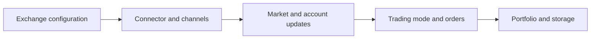
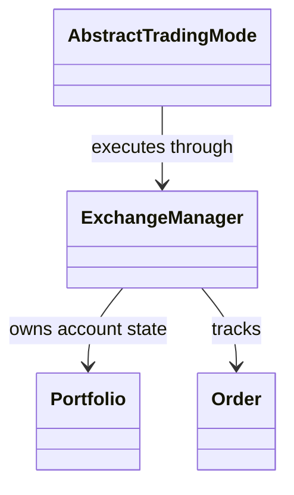
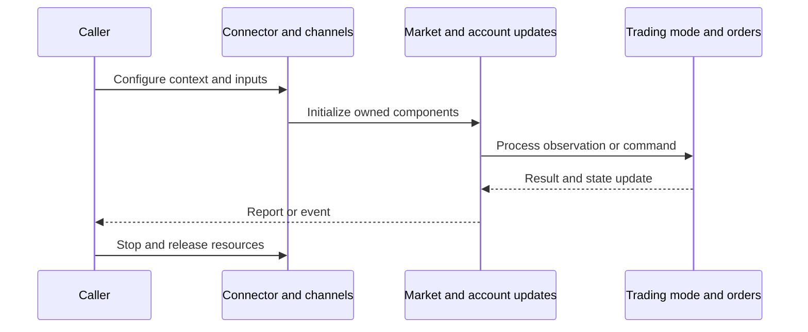
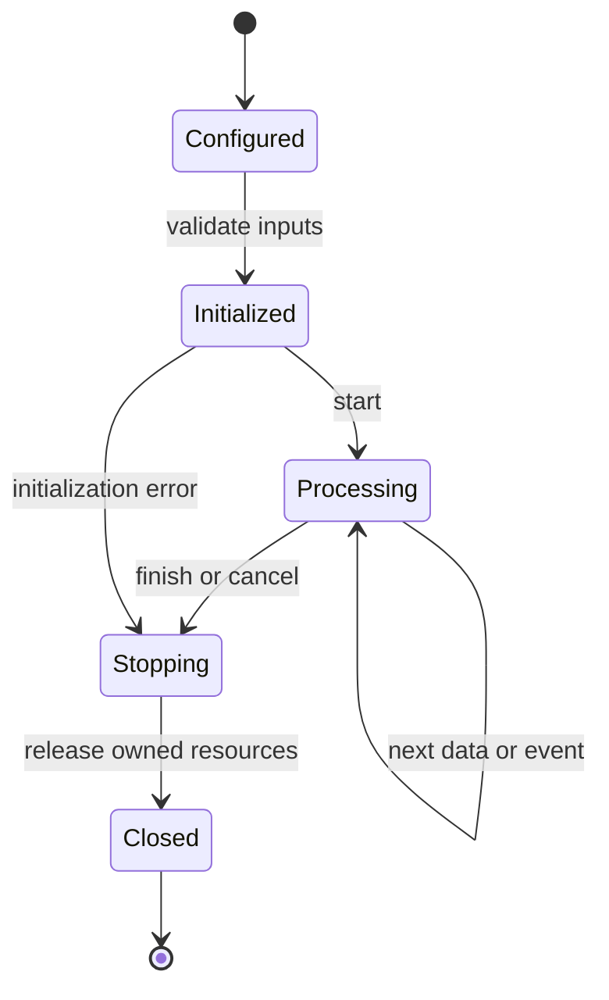
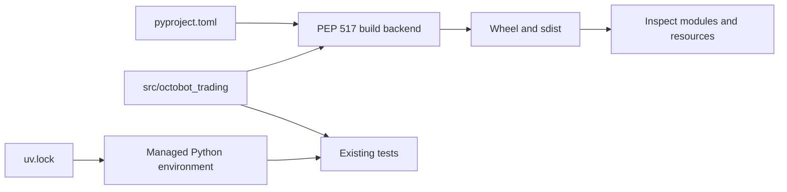
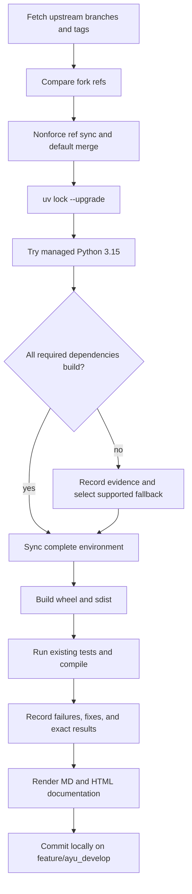

# OctoBot-Trading: architecture and development

Trading implements exchange access, account state, orders, portfolios, risk-related personal data, and trading-mode execution. It supports live exchanges and simulated state used during backtesting.

## Components and boundaries

ExchangeManager coordinates market data and personal data through exchange channels. Connector classes isolate REST/websocket exchange behavior; CCXT adapts common exchange operations. Order and order-state types hold lifecycle transitions, decimal quantities, and chained order behavior. Portfolio and position managers account for execution effects. Trading modes translate evaluator or remote signals into concrete order actions; storage retains market/account snapshots.

The following class view names implementation classes. Cross-package types are supplied by the host ecosystem; arrows describe inheritance or usage, not copied ownership.

## Runtime workflow

Create and initialize an exchange manager, subscribe to market/account streams, update candles and personal data, evaluate a trading-mode trigger, adapt and validate decimal order quantities, submit or simulate an order, reconcile fills/cancellations, and persist state. Shutdown closes producers, exchange sessions, and storage.

This sequence is an architectural view of responsibility and resource ownership. Individual plugin, connector, and strategy implementations can add asynchronous events and error branches. The lifecycle below is a conceptual operating workflow, rather than a claim that every component has one shared state enum.

## Features and extension points

CCXT connectors; spot/futures modes; simulated orders; chained orders and cancellation policies; portfolio/position accounting; remote trading signals; blockchain wallet abstractions; historical collectors and storage.

Extend the owning component behind its existing public interface. Keep metadata and configuration alongside plugin/strategy resources. Exchange-specific behavior belongs in an adapter; strategy decisions belong in the strategy/evaluator layer; persistence schema and migrations belong with the storage implementation. Review the source map below before changing a boundary, and exercise the existing tests associated with that boundary.

## Packaging and dependency design

Uses sibling Commons and Backtesting via uv. Python 3.15 builds the complete native dependency graph using pycares’ supported system c-ares option; see [the exact build flags](development.md#native-python-315-dependency-build). All 905 original standalone cases pass. Existing fixture names and regular-expression literals support strict modern pytest/Python collection without changing assertions or adding cases.

The lock records exact package versions, hashes, platform markers, and local source mappings. Path sources deliberately bind related repositories in this workspace; clone sibling repositories at the documented names before synchronization. Published packaging metadata describes public dependencies, while uv source settings select this development workspace. Resolve dependency changes with uv lock --upgrade and retain the generated lock, then verify the same locked environment.

## Maintenance workflow

All upstream branches and tags are fetched. Fork updates use nonforce pushes; a divergent branch is merged without erasing fork history. The default branch is merged into feature/ayu_develop with package/resource conflicts reconciled in their installed locations. Build and test evidence is recorded before a local maintenance commit. Feature branch publication is a separate root-level action.

No existing test assertions are removed and no new test cases are introduced in this maintenance pass. Corrected fixtures preserve coverage while making paths, corruption inputs, and resource cleanup compatible with the selected interpreter. A failed test or unsupported dependency is reported explicitly in [validation](validation.md); package build success does not imply strategy correctness, profitability, or successful live connectivity.

## Source map

| Source | Responsibility and location |
| --- | --- |
| [exchange_manager.py](../src/octobot_trading/exchanges/exchange_manager.py) | src/octobot_trading/exchanges/exchange_manager.py |
| [ccxt_connector.py](../src/octobot_trading/exchanges/connectors/ccxt/ccxt_connector.py) | src/octobot_trading/exchanges/connectors/ccxt/ccxt_connector.py |
| [exchange_channel.py](../src/octobot_trading/exchange_channel.py) | src/octobot_trading/exchange_channel.py |
| [order.py](../src/octobot_trading/personal_data/orders/order.py) | src/octobot_trading/personal_data/orders/order.py |
| [order_factory.py](../src/octobot_trading/personal_data/orders/order_factory.py) | src/octobot_trading/personal_data/orders/order_factory.py |
| [portfolio.py](../src/octobot_trading/personal_data/portfolios/portfolio.py) | src/octobot_trading/personal_data/portfolios/portfolio.py |
| [abstract_trading_mode.py](../src/octobot_trading/modes/abstract_trading_mode.py) | src/octobot_trading/modes/abstract_trading_mode.py |
| [trading_signal_bundle_builder.py](../src/octobot_trading/signals/trading_signal_bundle_builder.py) | src/octobot_trading/signals/trading_signal_bundle_builder.py |
| [storage_manager.py](../src/octobot_trading/storage/storage_manager.py) | src/octobot_trading/storage/storage_manager.py |
| [blockchain_wallet.py](../src/octobot_trading/blockchain_wallets/blockchain_wallet.py) | src/octobot_trading/blockchain_wallets/blockchain_wallet.py |
| [pyproject.toml](../pyproject.toml) | pyproject.toml |
| [uv.lock](../uv.lock) | uv.lock |
| [README.md](../README.md) | README.md |

## Further reading

Use [development.md](development.md) for reproducible commands and [validation.md](validation.md) for exact interpreter, dependency, build, test, and blocker evidence. The equivalent [HTML architecture document](ayu-develop.html) supports browsing and rendered diagrams.
